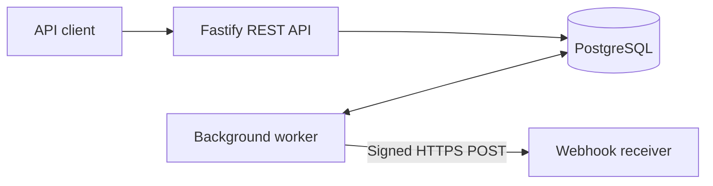

# RelayForge API

**Reliable webhook delivery with authentication, idempotency, signed payloads, and automatic retries.**

RelayForge is a backend portfolio project that simulates the event-delivery infrastructure used by SaaS platforms. Developers create a webhook destination, publish an event once, and follow each delivery attempt through a small REST API. A separate worker signs outgoing requests and retries temporary failures with exponential backoff.

The application uses only synthetic examples. It is an original demonstration project, not code extracted from any company system.

## Technology

- **Backend:** Node.js 22+, TypeScript, Fastify 5
- **Database:** PostgreSQL 16, SQL migrations, transactions, parameterized queries
- **Security:** JWT authentication, `scrypt` password hashes, HMAC-SHA256 delivery signatures
- **API contract:** TypeBox JSON Schema and interactive OpenAPI/Swagger UI
- **Reliability:** idempotency keys, `FOR UPDATE SKIP LOCKED` job claiming, retries, failed-delivery status
- **Engineering:** Vitest tests, Docker Compose, TypeScript strict mode, GitHub Actions CI

## Architecture



The HTTP API and the worker run as separate processes. Publishing an event writes its deliveries in a database transaction. Workers atomically claim due deliveries, submit signed requests, and record success or schedule the next attempt. Delivery is **at least once**, so webhook consumers should also deduplicate incoming event IDs.

## Quick start — Docker Compose

**Requirements:** Docker Engine and Docker Compose.

```bash
cp .env.example .env
```

Generate a unique JWT secret:

```bash
openssl rand -hex 32
```

Replace the `JWT_SECRET` value in `.env` with the generated secret. Then start the database, migration, API, and worker:

```bash
docker compose up --build
```

- API: <http://localhost:3000>
- Swagger UI: <http://localhost:3000/docs>
- Health check: <http://localhost:3000/health>
- DB readiness: <http://localhost:3000/ready>

The Postgres and API ports bind to `127.0.0.1` in the provided Compose setup. Stop services with `docker compose down`; a named volume preserves the database between restarts.

## Try the API

1. **Register**, using a password of at least 12 characters:

   ```bash
   curl -X POST http://localhost:3000/auth/register \
     -H 'content-type: application/json' \
     -d '{"email":"demo@example.com","password":"change-this-demo-password"}'
   ```

   The response has a `token` (JWT). Set it in your shell:

   ```bash
   TOKEN='paste-token-here'
   ```

2. **Create a destination**. Replace the example URL with a public **HTTPS URL you control** to receive actual delivery attempts:

   ```bash
   curl -X POST http://localhost:3000/v1/endpoints \
     -H "authorization: Bearer $TOKEN" \
     -H 'content-type: application/json' \
     -d '{"url":"https://example.com/webhooks","eventTypes":["order.created"]}'
   ```

   The response contains a `signingSecret`. It is returned at creation only; store it securely if you want to verify webhook signatures.

3. **Publish an event**:

   ```bash
   curl -X POST http://localhost:3000/v1/events \
     -H "authorization: Bearer $TOKEN" \
     -H 'content-type: application/json' \
     -d '{"type":"order.created","idempotencyKey":"demo-order-10001","payload":{"orderId":"10001","total":149.90}}'
   ```

   Repeating the same request with the same idempotency key returns the existing event ID and `"duplicate": true`. Reusing the key with different event data returns HTTP 409.

4. **Inspect delivery results**:

   ```bash
   curl http://localhost:3000/v1/deliveries \
     -H "authorization: Bearer $TOKEN"
   ```

   Example.com is a placeholder, not a test receiver: deliveries sent there will likely fail and retry. Use an HTTPS webhook testing endpoint or your own receiver to see successes.

## Endpoint reference

| Method | Path | Purpose | Auth |
|---|---|---|---|
| `GET` | `/health` | Liveness | No |
| `GET` | `/ready` | Database readiness | No |
| `POST` | `/auth/register` | Register an account | No |
| `POST` | `/auth/login` | Obtain a JWT | No |
| `POST` | `/v1/endpoints` | Create a webhook destination | Bearer JWT |
| `GET` | `/v1/endpoints` | List own destinations, excluding secrets | Bearer JWT |
| `POST` | `/v1/events` | Queue idempotent event deliveries | Bearer JWT |
| `GET` | `/v1/deliveries` | Inspect own 100 latest deliveries | Bearer JWT |

The OpenAPI definition is generated from the same JSON schemas used for request validation and response serialization.

## Webhook signature

Each outgoing JSON request includes:

- `x-relayforge-event-id`: the stable event UUID
- `x-relayforge-attempt`: attempt number, starting at 1
- `x-relayforge-signature`: `sha256=<lowercase hexadecimal HMAC>`

The HMAC-SHA256 is computed over the **exact raw JSON body** using the destination's `signingSecret`. Receivers should compute their own HMAC and compare the bytes using a constant-time comparison. Deliveries are successful for HTTP 2xx responses. Other statuses and network errors retry up to **5 attempts** with bounded exponential backoff, then move to the `failed` state.

## Local development

**Requirements:** Node.js 22+, npm, PostgreSQL 16 (or Docker for Postgres).

```bash
npm ci
cp .env.example .env
# Generate and configure JWT_SECRET; set DATABASE_URL for your local DB.
npm run db:migrate
npm run dev
```

Run the worker in another terminal:

```bash
npm run dev:worker
```

Quality checks (tests use a fake repository and do not need a running database):

```bash
npm run check
npm run build
```

## Design decisions and trade-offs

- **Transactional enqueue:** an event and all its initial deliveries are persisted together; uniqueness is enforced by `(user_id, idempotency_key)`.
- **Safe concurrent claiming:** PostgreSQL row locking with `SKIP LOCKED` prevents multiple workers from claiming the same available job simultaneously. A timed-out `processing` job can be reclaimed if a worker crashes, so recipients must support at-least-once delivery.
- **Bounded retry:** five total attempts and a capped backoff reduce repeated pressure on a failing destination.
- **Tenant separation:** endpoint and delivery reads are scoped by the signed-in user's ID; signing secrets do not appear in list responses.
- **Controlled input:** JSON schemas limit payload size and allowed field types; endpoints must use HTTPS and cannot be obvious localhost, internal-domain, or literal-IP destinations.

### Production hardening still required

This is a **portfolio/demo API**, not a production webhook service. In production, also add DNS resolution and public-IP verification *at connection time*, network-level egress restrictions to mitigate SSRF and DNS rebinding, encrypted-at-rest signing secrets, full observability, fair scheduling and per-tenant quotas, key rotation, stronger operational recovery semantics, and database-backed/distributed rate limiting. Do not deploy it on an unrestricted public network as-is.

## Project structure

```text
src/
  app.ts          Fastify routes, schemas, Swagger, auth
  pg-store.ts     PostgreSQL repository and transactions
  dispatcher.ts   Signed HTTP delivery and retries
  worker.ts       Background polling loop
  security.ts     Password hashing, HMACs, URL validation
  retry.ts        Retry policy
scripts/migrate.ts
sql/001_init.sql
tests/             HTTP, security and delivery unit tests
compose.yaml
Dockerfile
```

## License

MIT — see [LICENSE](LICENSE).
